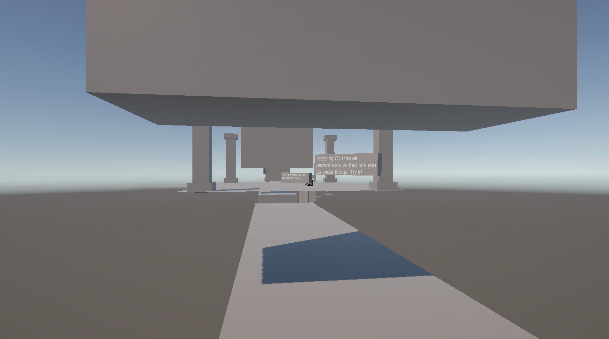

# A-3D-Space
A 3d rouge-like game that focuses on movement. There is multiple movement mechanics, such as sliding and diving(sort of)! (IN DEVELOPMENT) 

I made this game because I wanted a break from my other project. I also had the insparation from games like Nullscape and Grace! (roblox games, ikik 😔)

Controls:

WASD is used to move.

SHIFT is used to run.

SPACE is used to jump.

C is used to crouch.

SHIFT + C is used to slide.

SPACE + C is used to dive.

R to reset the level.

I currently have a test map, where you can test the mechanics.

Unfortunately, I can't upload the build file due to it being too large. So, please go to https://hi-ninjaman.itch.io/a-3d-space to download and play. The main script is still here though, will get changed.

